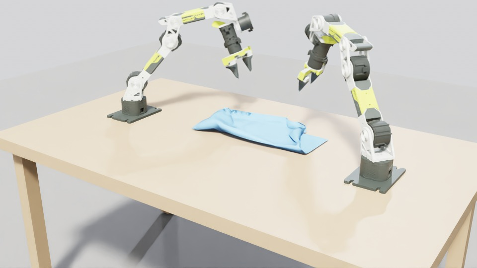

# reBot B601 — Bimanual Cloth Folding in Isaac Sim 5.1

Two Seeed reBot Arm T701 HT (B601) arms pinch the near edge of a felt cloth,
carry it over the midline, and release it as a clean half-fold — first with a
scripted expert, then with a **SmolVLA** policy trained on 62 demonstrations.

| Result | Value |
|---|---|
| Fold error (closed-loop eval) | **0.00 cm** |
| Eval success rate | **6 / 6** episodes (run3 checkpoint) |
| Edge gap (near edge to far edge) | 0.7 – 5.4 cm |
| Demonstrations | 62 episodes / 21,080 frames, all successful |
| Training | SmolVLA, expert-only finetune (frozen vision encoder) on a 6 GB RTX 4050 |
| Policy inference | CPU (Isaac Sim occupies ~5.2 GB of the 6 GB GPU) |

Demo (smooth GUI replay of episode 2, 0.00 cm fold error):
**[`outputs/fold_ep2_gui.mp4`](outputs/fold_ep2_gui.mp4)**



### Dataset

The 80-episode / 27,200-frame LeRobot v3 dataset (2.5 GB, top + front
256×256 cameras, 14-D state/action) is on the Hugging Face Hub:
[`ArunMurugesan/bimanual_rebot_cloth_folding_sim`](https://huggingface.co/datasets/ArunMurugesan/bimanual_rebot_cloth_folding_sim).

---

## How it works

```
              ┌──────────────────────────────────────────────────────┐
  cameras ───►│  SmolVLA policy  (top + front 256×256, 14-D state)    │
  joint q ───►│  chunk_size 50, replan every 25 steps                │
              └──────────────────────────┬───────────────────────────┘
                                         │ 14-D action
                                         ▼
              ┌──────────────────────────────────────────────────────┐
              │  RebotClothEnv  (Isaac Sim 5.1, PhysX GPU)           │
              │  two B601 arms · 0.52×0.52 m felt cloth · 20 Hz      │
              └──────────────────────────────────────────────────────┘
```

* **State / action (14-D):** `[left q(6), left gripper, right q(6), right gripper]`
* **Task string:** `fold the cloth in half`
* **Fold primitive:** true pinch-and-carry along a circular arc about the cloth
  midline (`fold_y = 2·midline_y − grasp_y`), release in the air, retreat.
* **Success metric:** the mean y of the near-half vertices gives a fold fraction
  in [0, 1]; the fold error is the remaining distance to a full half-fold in cm
  (success ≤ 5 cm). An edge-alignment profile is reported alongside it
  (positive gap = near edge short of the far edge).

---

## Repository layout

```
rebot_cloth_fold/
├── wam_fold/
│   ├── config.py             # SceneCfg / RobotCfg / ClothCfg / FoldTaskCfg
│   ├── scene.py              # Cloth (world-space mesh, snapshot, jitter), table, lights
│   ├── kinematics.py         # URDF serial chain + damped least-squares IK
│   ├── rebot_kinematics.py   # reBot-specific joint map / TCP
│   ├── rebot_env.py          # RebotClothEnv: GPU physics, gains, cameras, metrics
│   ├── control_policy.py     # scripted pinch-and-carry FSM + success metrics
│   └── run_episodes.py       # one-episode-per-process data collection
├── scripts/
│   ├── fetch_assets.py       # clone the Seeed reBot assets (URDF + USD)
│   ├── 02_build_rebot_usd.py # URDF → USD (ArticulationRootAPI fix)
│   ├── collect_batch.sh      # batch collection with cloth jitter, discards failures
│   ├── 07_convert_official_lerobot.py  # raw pickles → LeRobot v3 dataset
│   ├── 08_eval_smolvla.py    # closed-loop eval (+ --save-actions)
│   ├── 09_replay_gui.py      # smooth GUI replay of a saved action sequence
│   ├── 10_export_stats_from_ckpt.py  # recover normalization stats from a checkpoint
│   └── run_gui_eval.sh       # live GUI eval wrapper (offline HF, clean UI)
├── scene/rebot_cloth_fold.py # standalone scene builder / renderer
├── outputs/
│   ├── fold_ep2_gui.mp4      # demo recording
│   ├── actions_ep2.npz       # exact 340-step action sequence (0.00 cm fold)
│   ├── smolvla_run3_stats.json  # training normalization stats (from the checkpoint)
│   └── record_ep2_keyframes/ # start / approach / carry / release / final
├── NOTES.md                  # full engineering log (phases 0–7, gotchas)
├── REPRODUCIBILITY.md        # verification checklist
└── requirements.txt
```

Large assets, datasets and checkpoints are **not** committed (see below).

---

## Requirements

* Ubuntu 22.04, NVIDIA GPU with ≥ 6 GB VRAM (tested: RTX 4050 Laptop, 6 GB)
* Isaac Sim **5.1.0** (`pip install "isaacsim[all]==5.1.0.0"`), Python 3.11
* `lerobot==0.4.2`, `numpy==1.26.0`, `Pillow`, `num2words`, `huggingface_hub`
* ~2 GB free disk for assets, ~10 GB for a dataset/checkpoints (use an external
  drive if the root filesystem is small — Isaac Sim's shader cache also lives
  on `/`)

```bash
git clone https://github.com/dreamerarun/bimanual_rebot_cloth_folding_sim.git
cd rebot_cloth_fold

conda create -n leisaac python=3.11 -y
conda activate leisaac
pip install "isaacsim[all]==5.1.0.0"
pip install -r requirements.txt
```

All Isaac Sim entry points must be launched with the environment stripped of
the system Python paths, otherwise Kit picks up incompatible libraries:

```bash
env -u PYTHONPATH -u LD_LIBRARY_PATH ~/miniconda3/envs/leisaac/bin/python -u <script>
```

---

## Setup: assets and USD

```bash
# 1. Clone Seeed's reBot assets (URDF, meshes, source USD)
python scripts/fetch_assets.py          # → assets/rebot_t701/

# 2. Convert the URDF to the flat USD used by the env (one-time)
env -u PYTHONPATH -u LD_LIBRARY_PATH \
  ~/miniconda3/envs/leisaac/bin/python scripts/02_build_rebot_usd.py
# → assets/rebot_t701/usd/rebot_b601_flat.usd  (6 revolute + 2 prismatic)
#   plus assets/rebot_t701/usd/configuration/rebot_b601_flat_base.usd
```

---

## Quick demo — no checkpoint required

`outputs/actions_ep2.npz` contains the exact action sequence that produced the
0.00 cm fold. Replaying it needs no model and no training data:

```bash
env -u PYTHONPATH -u LD_LIBRARY_PATH \
  ~/miniconda3/envs/leisaac/bin/python -u scripts/09_replay_gui.py \
  outputs/actions_ep2.npz \
  --no-obs-cameras \
  --frames-dir /tmp/fold_frames \
  --video /tmp/fold_ep2.mp4 \
  --hold-seconds 120
```

Expected console output:

```
[replay] 340 actions ... (recorded fold_error=0.00 cm, edge_gap=1.6 cm)
[replay] step 240 fold_err=  0.00 cm
[replay] DONE success=True fold_error=0.00 cm
[replay] recorded fold_error=0.00 cm → replay delta=0.00 cm
```

The GUI plays at a steady 20 Hz (no policy inference in the loop) and writes
`/tmp/fold_ep2.mp4` at 960×540. The cloth contact state is not bit-identical
run-to-run, so the edge gap may vary by 1–3 cm while the fold error stays 0.

---

## Trained policy (optional)

The exact checkpoint behind the 6/6 closed-loop result is attached to the
[`v1.0-smolvla-run3` release](https://github.com/dreamerarun/bimanual_rebot_cloth_folding_sim/releases/tag/v1.0-smolvla-run3)
(727 MB tar.gz). It needs no dataset to run — the normalization statistics it
was trained with are committed as `outputs/smolvla_run3_stats.json`
(recovered from the checkpoint with
`scripts/10_export_stats_from_ckpt.py`).

```bash
curl -L -O https://github.com/dreamerarun/bimanual_rebot_cloth_folding_sim/releases/download/v1.0-smolvla-run3/smolvla_run3_pretrained_model.tar.gz
tar -xzf smolvla_run3_pretrained_model.tar.gz -C /tmp   # → /tmp/smolvla_run3

env -u PYTHONPATH -u LD_LIBRARY_PATH \
  ~/miniconda3/envs/leisaac/bin/python -u scripts/08_eval_smolvla.py \
  --ckpt /tmp/smolvla_run3 \
  --stats outputs/smolvla_run3_stats.json \
  --episode-index 1 --max-steps 340 \
  --save-actions /tmp/actions_ep1.npz
```

---

## Full pipeline

### 1. Collect scripted demonstrations

One episode per fresh process is required: PhysX deformable cloth state cannot
be restored between episodes.

```bash
# single episode
env -u PYTHONPATH -u LD_LIBRARY_PATH \
  ~/miniconda3/envs/leisaac/bin/python -m wam_fold.run_episodes \
  --episodes 1 --out data/raw --max-steps 340 --cloth-jitter 0.02 --seed 0

# batches (discards failures, merges metadata.json)
bash scripts/collect_batch.sh <start-index> <count> 0.02
```

`--cloth-jitter 0.02` offsets the cloth mesh by ±2 cm XY at build time (the
root Xform stays identity). This is the single biggest factor for the policy's
generalization — don't collect all demonstrations from one cloth pose.

### 2. Convert to a LeRobot v3 dataset

```bash
env -u PYTHONPATH -u LD_LIBRARY_PATH ~/miniconda3/envs/leisaac/bin/python \
  scripts/07_convert_official_lerobot.py \
  --raw data/raw --out data/lerobot_official
```

### 3. Train SmolVLA (fits 6 GB with expert-only training)

```bash
lerobot-train \
  --dataset.repo_id=ArunMurugesan/bimanual_rebot_cloth_folding_sim \
  --dataset.root=data/lerobot_official \
  --policy.type=smolvla \
  --policy.pretrained_path=lerobot/smolvla_base \
  --policy.device=cuda --policy.use_amp=true \
  --policy.train_expert_only=true --policy.freeze_vision_encoder=true \
  --policy.resize_imgs_with_padding="[256,256]" \
  --policy.chunk_size=50 --policy.n_action_steps=25 \
  --batch_size=1 --num_workers=2 \
  --steps=24000 --save_freq=6000 \
  --output_dir=outputs/train/smolvla_run3 \
  --wandb.enable=false
```

~0.09 s/step (~19 min for 24k steps); final loss ≈ 0.011. Checkpoints are
1.5 GB each, so keep them outside the repo.

### 4. Closed-loop evaluation

```bash
env -u PYTHONPATH -u LD_LIBRARY_PATH \
  ~/miniconda3/envs/leisaac/bin/python -u scripts/08_eval_smolvla.py \
  --ckpt /tmp/smolvla_run3 \
  --stats outputs/smolvla_run3_stats.json \
  --episode-index 1 --max-steps 340 \
  --save-actions /tmp/actions_ep1.npz
```

(`--stats` is the dataset's `meta/stats.json`; a copy for the released
checkpoint is committed, so no dataset is required for evaluation.)

Runs one episode in a fresh process. The policy runs on **CPU** (Isaac Sim
occupies most of the GPU), so each 25-step inference chunk takes ~1.6 s.
Add `--gui --clean-ui` to watch, `--save-frames` to dump camera frames.

---

## What is *not* in this repository

| Item | Why | How to get it |
|---|---|---|
| `assets/rebot_t701/` (436 MB) | Seeed's upstream repo, includes a 95 MB USD | `python scripts/fetch_assets.py` |
| Raw pickles (80 eps, 10 GB) | Too large for git | regenerate with steps 1–2 |
| LeRobot v3 dataset (80 eps, 2.5 GB) | Too large for git | [Hugging Face Hub](https://huggingface.co/datasets/ArunMurugesan/bimanual_rebot_cloth_folding_sim) |
| Training checkpoints (1.2 GB) | Exceeds GitHub's git file limit | [release `v1.0-smolvla-run3`](https://github.com/dreamerarun/bimanual_rebot_cloth_folding_sim/releases/tag/v1.0-smolvla-run3) or retrain (step 3) |
| Evaluation frame dumps / logs | Reproducible artifacts | regenerate |

---

## Engineering notes (why it looks the way it does)

* **One episode per process.** PhysX overwrites `Cloth.restore()`, so the
  deformable cannot be reset between episodes; batch collection spawns a fresh
  process per attempt.
* **Never translate the cloth root.** Mesh points are authored in world
  coordinates; moving the root teleports the sheet and breaks IK. Jitter is
  applied to the points *before* the deformable is cooked.
* **Fabric must be off** for cloth readback (`/physics/fabricEnabled=False`,
  `SimulationManager.enable_fabric(False)`), otherwise the success metric reads
  stale points.
* **Offline HF is required** for evaluation: `HF_HUB_OFFLINE=1` is set inside
  `08_eval_smolvla.py`; otherwise the loader re-validates weights online and
  can hang.
* **Only one Isaac Sim GUI process** fits in 6 GB. Waiting windows
  (`--hold-seconds`) must be closed before launching another, or CUDA OOM
  corrupts PhysX.
* **Live GUI eval is choppy** by construction (CPU inference). Record with
  `09_replay_gui.py` instead: it replays a saved action sequence with no model
  in the loop, so the GUI is smooth and the MP4 is frame-accurate.
* **Corner grasping is not a half-fold.** The fold mirrors the grasped edge
  across the horizontal midline; a corner grasp would mirror to the opposite
  corner and crumple the cloth. A diagonal fold needs a different primitive.
* `train_expert_only=true` + `freeze_vision_encoder=true` is what makes
  SmolVLA fit in 6 GB. `lerobot 0.4.2` has no `gradient_checkpointing` config
  field despite the shared CLI help.
* **Training snapshot vs. current raw set.** run3 was trained on the
  62-episode snapshot (21,080 frames). The raw folder was later expanded to
  80 episodes (27,200 frames) and reconverted, which overwrote `meta/stats.json`.
  The shipped stats are therefore recovered from the checkpoint itself, so they
  match the trained weights exactly — using the newer dataset stats still folded
  but widened the mean edge gap from 1.4 cm to 4.2 cm.

The full phase-by-phase log, including failed approaches and measurements, is
in [`NOTES.md`](NOTES.md). A step-by-step verification checklist is in
[`REPRODUCIBILITY.md`](REPRODUCIBILITY.md).

---

## Acknowledgements

* [Seeed reBot Arm T701 HT / B601 assets](https://github.com/Seeed-Projects/reBot-Isaacsim)
* [LeRobot](https://github.com/huggingface/lerobot) and
  [SmolVLA](https://huggingface.co/lerobot/smolvla_base)
* NVIDIA Isaac Sim 5.1

Licence: MIT for this repository's code. The reBot assets retain their
upstream licence.
